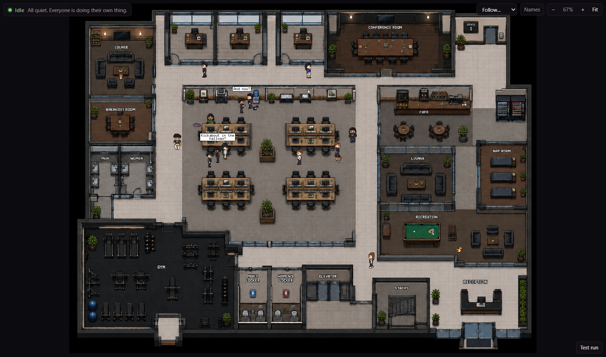
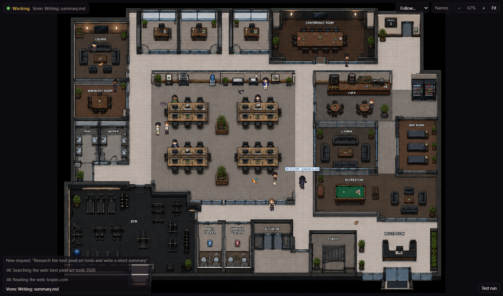
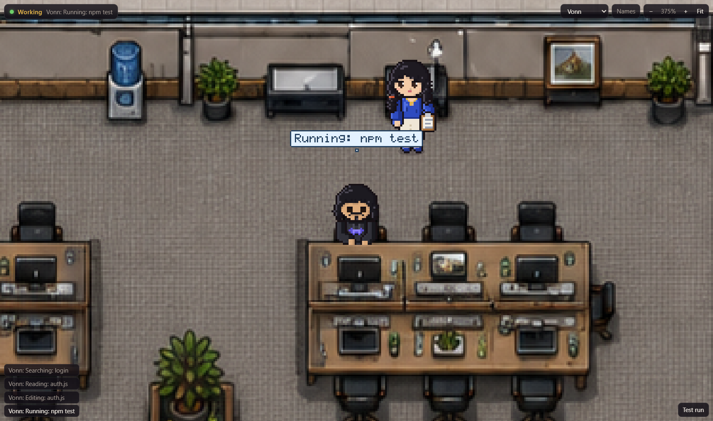
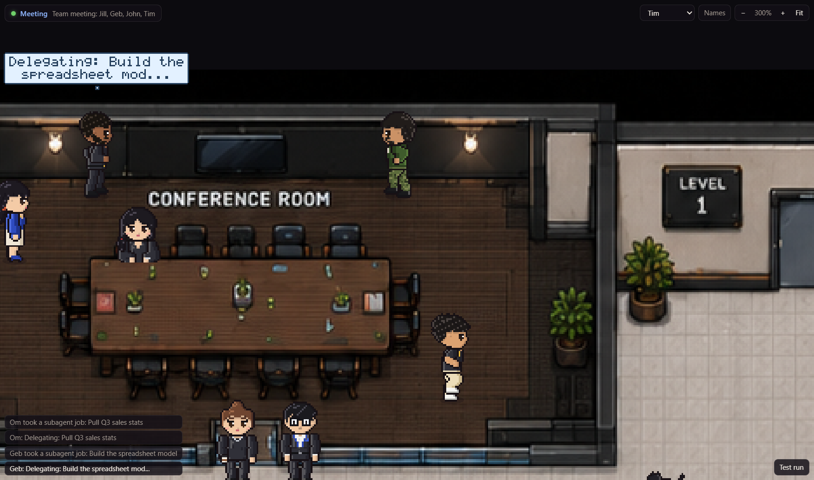
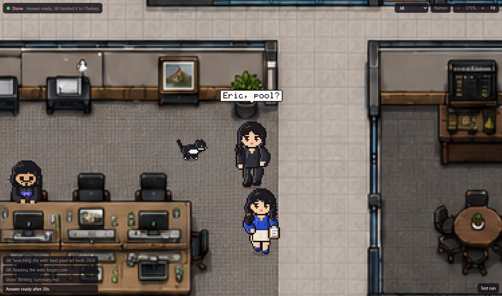

# 2D Office

**A pixel office that shows what Claude Code is doing while you wait for an answer.**

When you send Claude a prompt, a small window opens with an office inside it. The prompt is handed to the worker who owns that kind of job. They walk to their desk and get to work, and their thought bubble shows the real tool Claude is running. When Claude finishes, the worker hands the answer to the manager and an "Answer delivered" toast pops up. Everyone else in the office carries on with their day.

Status: the office runs every day on my machine and is wired into my own Claude Code. The code is not in this repo yet. It still has my friends in it (they agreed to it for personal use), so I need to swap in a default cast and add customization before I publish it. See [ROADMAP.md](ROADMAP.md).



## What it looks like in action

These are screenshots of the live window taken on 2026-11-02, using the built-in test requests. Name tags are switched off.

**A request comes in.** The status bar at the top says who has the job. The log in the bottom left shows each step Claude takes, like "Searching the web" and "Reading the web: lospec.com".



**The worker at their desk.** The engineer sits at the desk while Claude edits `auth.js`. The manager stands behind with her clipboard.



**Big jobs start with a meeting.** When Claude starts two or more subagents, or the prompt is large, the team meets in the conference room first. Each subagent job goes to a worker, and the bubble shows what is being delegated.



**The hand-off.** When Claude stops, the worker says "Done! Here." and passes the answer to the manager. The toast shows how long it took.



## How it connects to Claude Code

```
Claude Code event
  -> hook script (async, never blocks Claude)
  -> local server on 127.0.0.1:47821
  -> Server-Sent Events stream
  -> office window: the job goes to the right worker, who acts it out
```

The hook listens to 7 Claude Code events:

| Claude event | what happens in the office |
|---|---|
| UserPromptSubmit | the receptionist calls it in, the manager reads it and walks it to the owner |
| PreToolUse / PostToolUse | the owner of that tool works at their desk and the bubble shows the action |
| subagent (Agent / Task tool) | another worker takes that piece. Two or more at once call a meeting |
| Notification | the manager shows a question mark and "Need your answer" |
| SubagentStop | that worker finishes their piece and drops off the job |
| Stop | the worker hands the answer over and the toast appears |
| SessionStart | the log notes a new Claude session |

Each tool goes to an owner. Shell, edits and tests go to the engineer. Web search and writing go to the researcher. Numbers go to the finance worker, spreadsheets to the spreadsheet worker, and so on. There are 11 working roles plus the manager.

**Privacy.** The hook only sends the event type, the tool name and a short trimmed detail, like a file name, a command's description, a search query or a website host. File contents, subagent prompts and full URLs never leave Claude. The server only listens on localhost.

## What is in the office

- **13 workers** drawn pixel by pixel in code. Each one has their own hair, outfit, sleeping pose and signature moves. The CEO does a kick combo with afterimages, the receptionist takes selfies, the strategist shadow boxes, and the project manager makes a big arm heart for his coworker.
- **5 pets** that wander around: two cats, a lop bunny, a pygmy hippo that follows the finance lead, and a small dragon that flies laps and burns paper balls left on the floor.
- **A full floor** measured off the office art: private offices, a conference room, open desks, a cafe, vending machines, a lounge, a nap room, a gym, washrooms, lockers and reception. It has 134 seats and spots people can use, and desks hide the legs of whoever is sitting behind them.
- **Idle life.** Workers with nothing to do follow their own needs and personalities. They get coffee, nap, work out, use the washroom and wash their hands after, and play real eight-ball pool with ball physics, scratches and a winner.
- **Conversations.** 176 chat scripts where each line answers the last one, shown in speech bubbles. Some chats turn into actions. "Want to grab a water?" sends both people to the cooler, and "Rack them up" starts a pool game.
- **Walking that looks right.** A* pathfinding keeps people in the middle of corridors and off the walls and glass. Everyone keeps about 28 px of personal space and steps around each other.

## Controls

| input | does |
|---|---|
| mouse wheel, `+` `-` | zoom |
| drag | pan |
| click someone | follow them |
| `0` | fit the whole floor |
| `F` | follow the manager |
| `N` | name tags on or off |
| Test run | send a practice request through the office |

## Tech

- Plain JavaScript, Node and an HTML canvas. No dependencies and no build step.
- About 6,800 lines across the server, the hook, the graphics and the simulation.
- 383 automated checks. They render all 18,469 animation frames and check every frame stays in bounds. They also check that every seat can be reached, run a simulated 25 minute work day with real Claude events, confirm the hook never leaks file contents, and test the live event stream.
- Opens as a small Edge or Chrome app window. An on and off switch stops it from opening when I don't want it.

## Where it came from

The first version (August 2026) ran in the terminal using half-block characters as pixels. The live window version came in September 2026 so it could replace Claude's "thinking" wait directly. Most of the work since then went into making movement and conversations feel natural: fixing walls people walked through, stopping people from sliding backwards, and making chats end in real actions.

## What comes next

The short version of [ROADMAP.md](ROADMAP.md):

- Swap my friends for a default cast and publish the code.
- Let anyone build their own team: names, looks, outfits and specialties.
- One worker per real subagent, so the office mirrors Claude's subagents one to one.
- Planning meetings that show the actual plan, plus text bubbles between workers that match real hand-offs.
- An "answer in" banner at the top, and bringing your Claude tab back to the front when the answer lands.

More detail in [docs/architecture.md](docs/architecture.md).

Built by John ([Phantom214020](https://github.com/Phantom214020)). Ideas and feedback are welcome in Issues.
